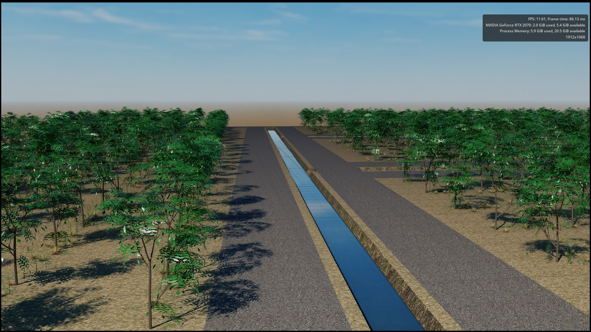
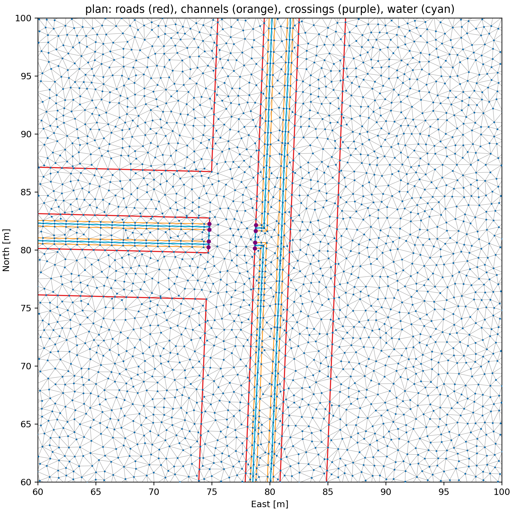
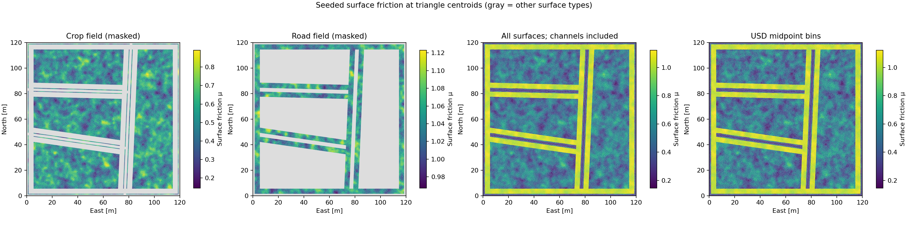
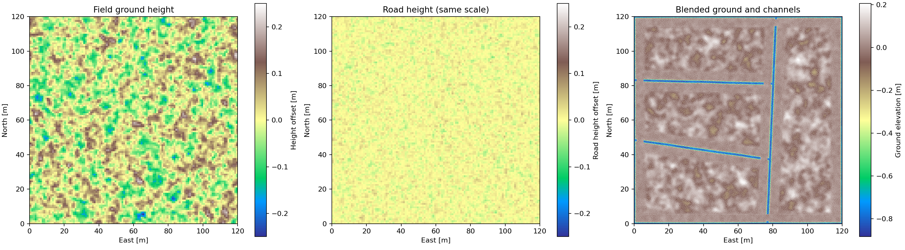
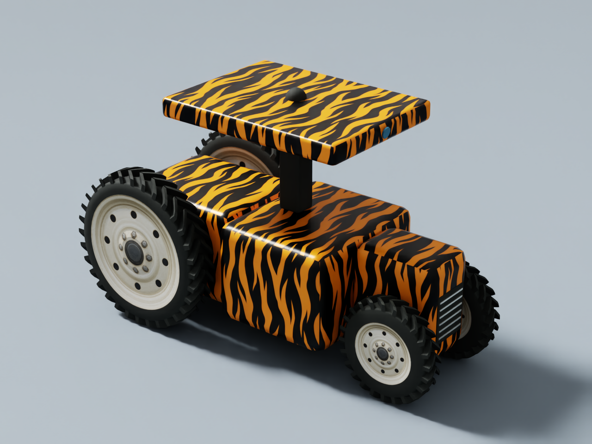
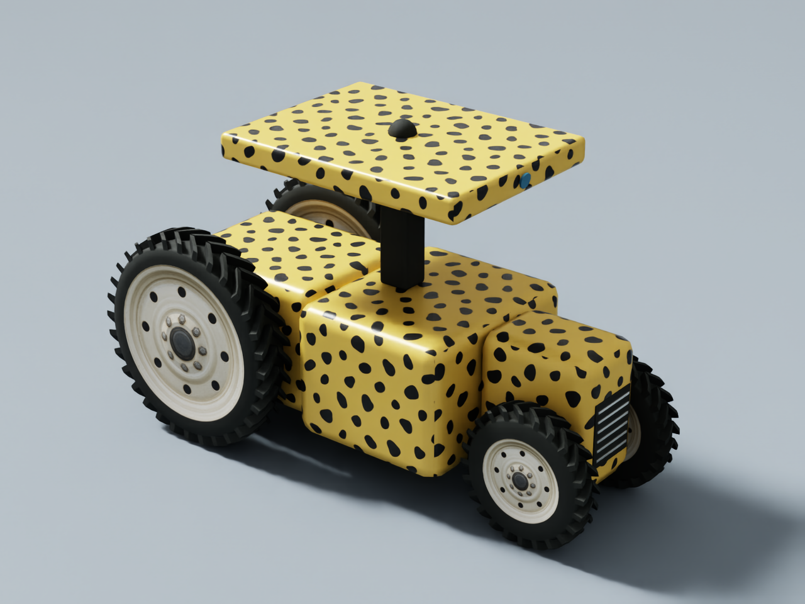
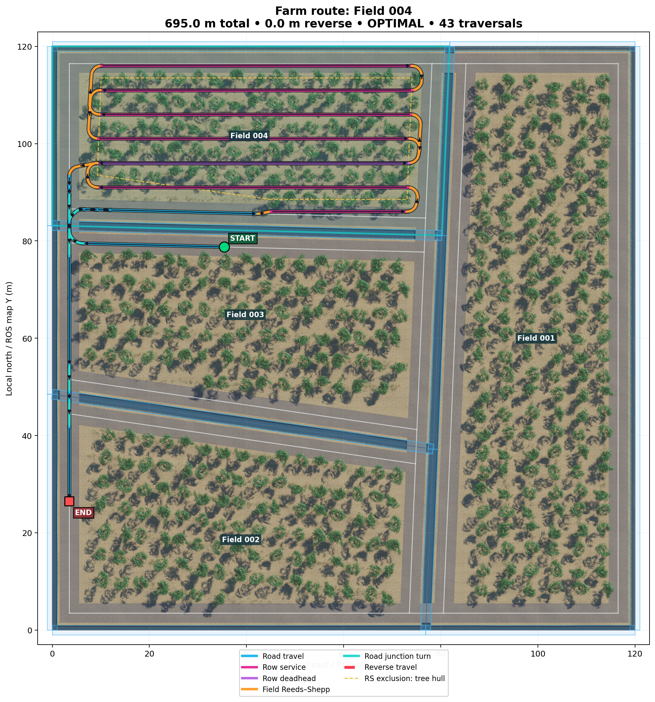
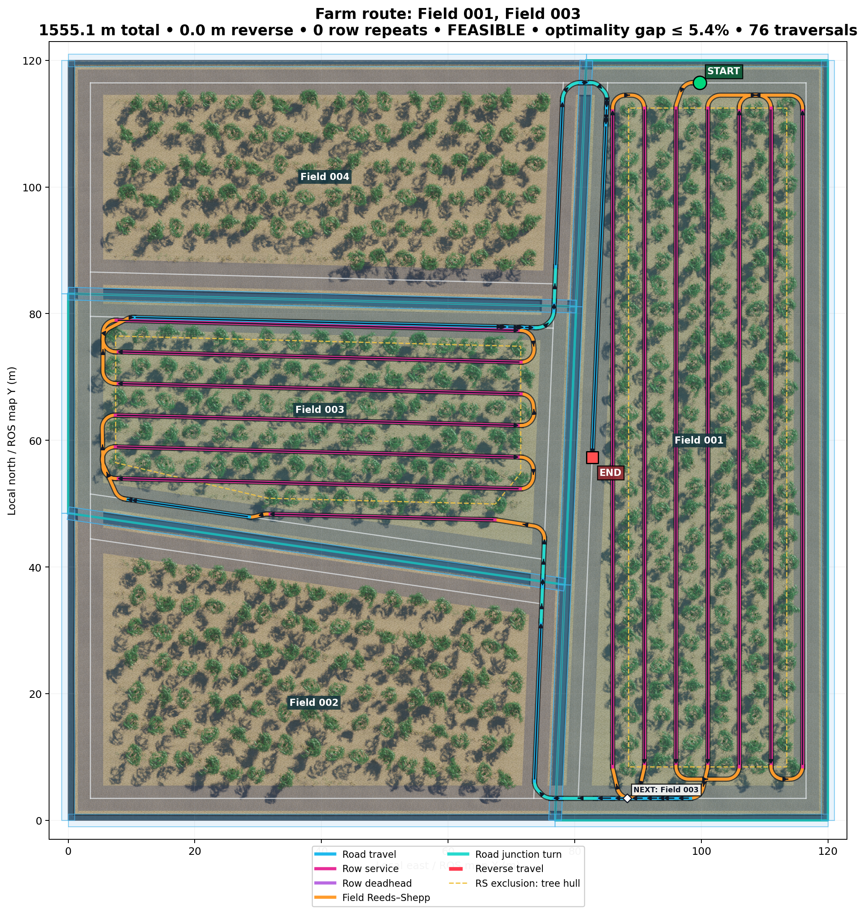
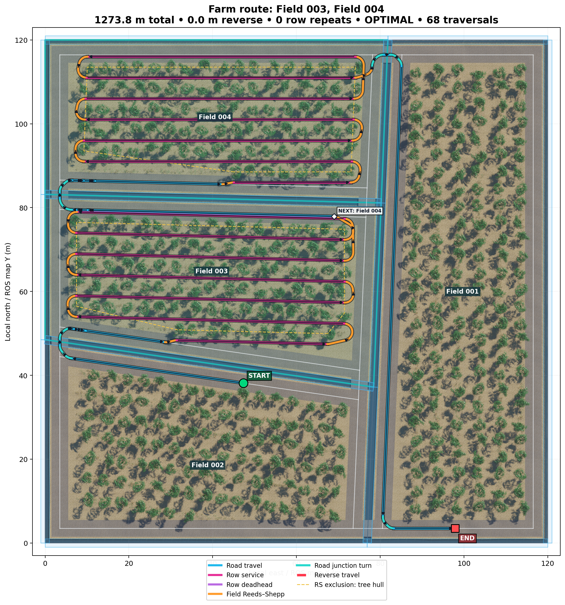
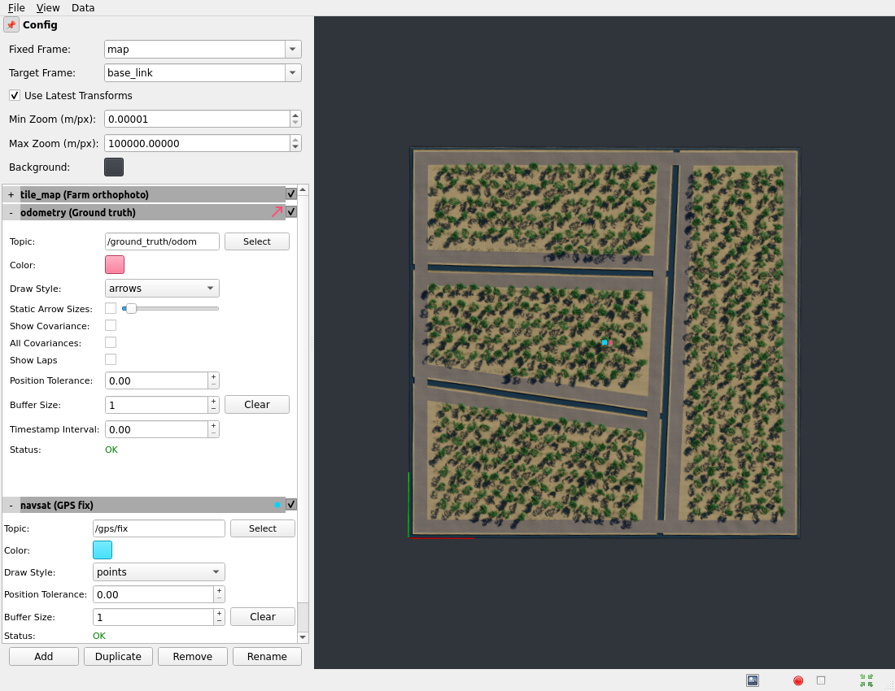

# farm-generator
Procedural farm generation via intermediate representation for robotics simulations. Tools for conversion to (minimally) IsaacSim/USD.

See `CLAUDE.md` for the full architecture/design reference.

## Setup

The complete showcase export and tractor simulation use the existing
`isaacsim61-cu13` environment. From the repository root, install the project
into that environment:

```bash
conda activate isaacsim61-cu13
python -m pip install --editable .
```

For tests, install `pytest` as well:

```bash
python -m pip install pytest
```

`pyproject.toml` defines the package and its runtime dependencies. The
`--editable` flag keeps local source edits visible without reinstalling.
Re-run the install command when project dependencies change. The dependency
versions are ranges, not exact pins. Isaac Sim itself is installed separately
in this conda environment; it is not a project dependency.

The Isaac Sim environment supplies the compatible USD Python packages used by
the tractor and farm exporters.

GIS writing uses the system `/usr/bin/python3` with Ubuntu GDAL and QGIS
bindings; the showcase script invokes that helper automatically.

## Running the tests

```bash
conda activate isaacsim61-cu13
python -m pytest tests/ -q
```

## Running the debug visualizer

`visualization/debug_view.py` is the primary dev tool (see CLAUDE.md
"Visualization"). Run it as a module from the repo root:

```bash
conda activate isaacsim61-cu13
python -m visualization.debug_view
```

This generates a farm for 5 seeds and writes, per seed, into
`debug_out/farm_scenes/`:
- `farm_seed_<N>.png` — a static plot (parcels/roads/crossings/trees/weed
  zones), at 300 DPI so tree-level detail is actually legible.
- `farm_seed_<N>.yaml` — the full `FarmScene` IR plus the
  `FarmGenerationConfig` that produced it (see `farm_ir/serialize.py`),
  human-readable and round-trippable. This is what a future USD/Gazebo
  exporter will read as input.

`debug_out/` is scratch output (gitignored, aside from whatever's already
checked in for reference) — safe to delete and regenerate at any time.

## Running the example prototype

`examples/farm_mesh_prototype.py` is a self-contained reference prototype
(see CLAUDE.md "Example reference code") — read it as a spec of behavior,
not production code. Run directly:

```bash
conda activate isaacsim61-cu13
python examples/farm_mesh_prototype.py
```

It generates and validates 5 seeds and saves plots to
`debug_out/examples/`.

## Generating tree and weed assets

The vegetation geometry is generated procedurally rather than sourced from a
library of predefined or licensed tree and weed models. The asset-generation
algorithms were originally developed in the
[FarmGeneration repository](https://github.com/StuartGJohnson/FarmGeneration)
and copied into `generation/asset_generation/` so this repository can build
the same assets independently.

Run the standalone asset build from the repository root:

```bash
conda activate isaacsim61-cu13
python examples/generate_procedural_assets.py
```

This creates four seeded pecan-tree variants and one seeded prototype for each
of dry grass, fennel, and ashweed under `debug_out/procedural_assets/`. The
tree generator constructs trunks, branching structure, and leaf geometry and
procedurally creates the bark and leaf textures. The weed generators construct
species-specific stems, blades, leaves, and flowers as appropriate, along with
their textures. The current tree seeds are 101, 202, 303, and 404; weed seeds
are 101, 202, and 303. Reusing the same seeds produces repeatable USDA geometry
and texture files.

Asset generation is deliberately separate from farm and mesh generation.
Farm export expects the prototype library to exist already and references its
USDA files through tree and weed `PointInstancer` prototypes. It does not
silently regenerate assets. Each farm seed then determines the prototype
choice, rotation, and scale at each vegetation placement without modifying the
underlying asset files.

## Generating hydrology ground meshes

Run `python examples/generate_procedural_assets.py` first to build the reusable,
fully procedural tree and weed prototype library. Then run
`python examples/generate_ground_meshes.py` to generate five 60 m by 60 m farm
IRs and corresponding USDA worlds in `debug_out/mesh/`. All five diagnostic
farms enable optimized tree-row orientation. Run
`python examples/generate_showcase_farm.py` separately to build the larger
120 m by 120 m presentation scene without replacing those regression cases.
The exporter uses deterministic Poisson-disc (blue-noise) points, producing
an amorphous Delaunay/Voronoi-dual mesh, plus exact constrained breaklines at
the shoulders and flat bottoms of the trapezoidal irrigation channels.
Each seed also produces a wireframe PNG showing all vertices, triangle edges,
and constrained breaklines classified by source: road boundaries in red,
channel contours in orange, and crossing/channel-slope intersections in purple.

The example enables exporter-side lateral channel undulation with a 10 cm
maximum amplitude, wavelengths strictly greater than 1 m, and 1 m curve
sampling. `ChannelUndulationConfig` controls these values and an optional seed
offset. Perturbations are deterministic per farm seed and logical hydrology
edge, taper to zero at network nodes, and are applied before deriving both the
channel shoulder and bottom breaklines. The `FarmScene` IR is not modified.

Before constructing the PSLG, the exporter creates first-class `ChannelFace`
objects. Each face corresponds to one parcel-side hydrology edge and owns its
paired shoulder and bottom arcs, exact shared corner endpoints, depth, and
endpoint cross-slope ribs. GEOS computes valid offset contours; those contours
are split at analytically determined corner stations and mapped one-to-one to
their source hydrology edges. This avoids recovering corners by nearby-vertex
indices and provides a reusable surface-patch representation for later roads
and bridge approaches.

At every authored parcel corner, a transverse PSLG breakline connects the
shoulder to the bottom contour. This prevents constrained Delaunay from
choosing its own miter across the channel slope and establishes a reusable
surface-patch convention for later roads and structures.

The example uses a 3.5 m road standoff, 7.5 m headlands, and 6.5 m sidelands.
Straight 4 m-wide roads are represented as first-class `RoadSurfacePatch`
footprints. Road boundaries are PSLG constraints, and their triangles are
exported in USD `Friction_Road_*` subsets for visual and physics material binding.

Road footprints replace, rather than overlay, the underlying terrain mesh.
Channel constraints are clipped out wherever a road exists, road-side boundary
vertices on flat ground are shared with the neighboring crop mesh, and only
depressed channel-profile vertices receive a raised road-deck copy. Explicit
vertical triangles close those channel-facing fill sides. No crossing-specific
constraints cut across the road top. Wall faces share the
`Friction_Channel_00` physics subset with the channel slopes and bottoms.
Each crossing is associated with the hydrology segment that geometrically
passes through its location, rather than by channel-midpoint proximity. The
purple wireframe diagnostics therefore cover the crossing/channel-slope
intersections at every crossing, including long channel segments.

Channel water is controlled by `hydrology_add_water` and
`hydrology_water_depth_fraction` in `FarmGenerationConfig`; the latter is the
filled fraction measured upward from the channel bottom. The waterline becomes
an additional ground-mesh PSLG contour. Each connected water polygon, after
subtracting road fills, is exported as a separate constrained `WaterSurface_*`
mesh with a transparent, reflective `UsdPreviewSurface` material, low
roughness, and an index of refraction of 1.333. The debug example enables water
at half channel depth and draws its closed boundaries in cyan.

Each USDA is a complete `/World` stage rather than a bare ground primitive. It
includes a `/World/Lights/Sky` dome light using
`assets/dome_texture_clouds.png`, a shadow-casting distant sun, a
gravity-enabled physics scene, and a static ground mesh collider. Material
geometry subsets map crushed grass to flat cropland, the channel texture to
slopes, bottoms, and vertical crossing walls, and darker gravel to road decks.
Face-varying world-space UVs repeat every texture at 2 m intervals. Vertical
crossing walls use horizontal-distance/elevation projection so their texture
does not collapse. The in-memory mesh retains the `crossing_wall` face class
for diagnostics, while USD material subsets group faces by surface friction.

Trees and weeds are authored as separate USD `PointInstancer` systems under
`/World/Vegetation`. Tree positions come directly from the farm IR. Each IR
weed zone records the exact cultivated row centerlines; weeds are sampled only
from Gaussian lateral profiles around those rows while excluding road and
channel footprints. `weed_row_density_per_m` is the expected instance count per
metre of row, integrated laterally, and `weed_row_falloff_m` is the lateral
standard deviation. Sampling is truncated at three standard deviations, with
no parcel-wide background weeds. Both systems reference the separately
generated prototype library; exporting a farm never silently generates or
mutates those assets. The diagnostic configuration uses 5 m row spacing and
4 m tree spacing and 4.5 expected weeds per row-metre. The current procedural
library contains four deterministic pecan-tree variants plus dry grass,
fennel, and ashweed. Individual tree and weed instances receive independently
seeded, repeatable random rotations about the vertical axis and modest scale
variation. Setting `optimize_tree_layout=True` retains the random
planting-grid anchor corner but uses the longer of its two incident parcel
edges as the tree-row direction; the default `False` preserves randomized
edge selection for layouts requiring more turns.

## 120 m showcase pecan farm



This is an HD Isaac Sim render of the 120 m by 120 m showcase pecan farm generated
by `examples/generate_showcase_farm.py`. This is modeled on flat, irrigated farmland
typical of the Sacramento Delta in California. Seed 1 produced 4 parcels, 16 channel
segments, 6 channel crossings, 453 trees selected from four procedural tree
variants, and 8,356 weeds concentrated along the optimized tree rows. The
showcase bundle is written under
`debug_out/farms/farm_seed_1_120m2/`.

The bundle contains `world/farm.usda`, `assets/`, `procedural_assets/`,
`farm.yaml`, and `gis/` with `farm.gpkg`, `orthophoto.tif`, `farm.qgz`,
`tiles/{16,17,18,19,20,21}/`, `map_frame.json`, and `semantic_reference.json`.
The USDA and QGIS project use relative asset paths so the directory can be
moved as a unit. The GeoPackage has separate fields, tree rows, roads and road
centerlines, trees, channels and channel centerlines, and crossings. Their IDs,
names, field membership, and network endpoint IDs support semantic queries.
Frontage roads carry `field_id`; crossing spurs and crossing footprints carry
`field_a` and `field_b`. Trees carry both `field_id` and `row_id`, and row
centerlines carry `field_id`. Rows used for navigation run from the first tree
trunk to the last; a row with only one tree keeps its row record with null
line geometry. The QGIS project labels fields and rows and includes relations
for selecting each field's roads and rows, then each row's trees.
`gis/map_frame.json` records the EPSG:32610 coordinate of the local ROS map
origin; subtract that coordinate from GIS eastings and northings to recover
local map X and Y. The orthophoto is rendered by Isaac Sim with a north-up
orthographic camera at 5 cm GSD by default. XYZ tiles use Web Mercator for
Mapviz. `python -m pytest tests/test_gis.py` checks semantic counts after
reloading the GeoPackage with GDAL.

Run `conda activate isaacsim61-cu13` and then
`python examples/generate_showcase_farm.py`. Use `--gsd 0.1` for a quicker
10 cm render, or `--vector-only` to inspect GIS vectors without launching
Isaac Sim.



The mesh detail above is a plan-view crop covering x=60–100 m and y=60–100 m
in the same East-right, North-up orientation as the full diagnostics. Gray
lines are Delaunay triangle edges, blue dots are mesh vertices, red lines are
road constraints, orange lines are channel constraints, cyan lines are water
boundaries, and purple markers identify crossing/channel-slope constraints. This
mesh is constrained to have edges along the channels, roads (and channel crossings)
and the farm parcels. The resolution of the mesh is nominally 1m in order to
sample variations in height and surface friction.

## Surface friction variation

Farm generation creates independent, seeded crop and road friction fields over
the entire domain and stores their samples and coefficient limits in the
`FarmScene` IR. Generator models live in `generation.orchestrator` as part of
`FarmGenerationConfig`, saved alongside the scene. The showcase example defines
crop, road, and constant channel friction explicitly in its config call. This happens before USD export. `FarmGenerationConfig` accepts nested
`SurfaceFrictionConfig` objects (or parameter dictionaries) with these defaults:

```yaml
farm_resolution_m: 1.0
channel_friction: 0.3
crop_surface:
  friction_mean: 0.65
  friction_variation_range: 0.30
  friction_scale_m: 5.0
  friction_spectral_slope: 4.0
  friction_seed: 1001
road_surface:
  friction_mean: 1.05
  friction_variation_range: 0.20
  friction_scale_m: 5.0
  friction_spectral_slope: 4.0
  friction_seed: 2001
```

The gravel/asphalt classification is now `road_surface_type`; `load_farm`
migrates the former string-valued `road_surface` in saved configurations.
Friction seeds are independent of the farm geometry seed. Identical parameters,
bounds, resolution, and seed reproduce the same field, regardless of exporter.

For frequency `f` in cycles/m, the target power spectrum is
`P(f) ∝ [1 + (f × friction_scale_m)²]^(-friction_spectral_slope/2)`.
The generator filters white-noise Fourier coefficients by `sqrt(P)`, removes
DC, and cuts radial frequencies above `1 / (2 × farm_resolution_m)`. A single
max-absolute normalization preserves the grid spectrum and mean while bounding
values to `mean ± variation_range/2`. The field need not reach both interval
endpoints. The FFT grid is periodic across the domain boundaries; continuous
bilinear sampling stays bounded and adds the usual grid-scale interpolation
smoothing. The specified spectrum applies to the stored grid, not an exact
power law at every arbitrary sample location.

Ground meshing uses `farm_resolution_m` from the IR as its default spacing;
the existing `flat_resolution` argument remains an explicit mesh-only override.
Each triangle samples the appropriate field at its XY centroid. Raised road
decks use road friction; channel bottoms, slopes, and crossing walls use the
constant channel value, including submerged channel faces. Water surfaces
remain visual meshes without collisions.

USD export accepts `friction_config=UsdFrictionConfig(n_sample_fields=10)`.
Each crop/road interval is divided into N midpoint bins, with
`delta_mu = friction_variation_range/N` and maximum error `delta_mu/2`.
A zero-width interval produces one material. The default export defines 21
physics materials: 10 crop, 10 road, and one channel. Nonempty face subsets form
a complete, non-overlapping `materialBind` partition, each with a visual material
and a separate `material:binding:physics` binding. Physics materials have matching
static/dynamic friction and zero restitution. Uniform face primvars retain both
the sampled and quantized mu for inspection.

Bringup connects all four tires to `/World/TireFrictionTable`, which maps each
physics material to its surface mu. The existing tire friction-versus-slip graph
then multiplies that value (1 at low/peak slip, decreasing to 0.85 at high slip).
Material static/dynamic friction is not multiplied into this tire lookup a
second time. Wheel-cylinder contacts with the ground are filtered so the
Vehicle 2 suspension queries supply the tire forces; chassis contacts remain
enabled. See NVIDIA's [vehicle materials documentation](https://docs.omniverse.nvidia.com/kit/docs/omni_physics/107.2/extensions/ux/source/omni.physx.vehicle/docs/collision_filtering_and_materials.html)
and [tire slip graph reference](https://docs.omniverse.nvidia.com/kit/docs/usdrt.scenegraph/7.6.2/api/classusdrt_1_1_physx_schema_physx_vehicle_tire_a_p_i.html).

Regenerate the showcase and its friction diagnostic, then drive it as before:

```bash
python examples/generate_showcase_farm.py
python -m bringup.launch_tractor --position 20 3.5 0
```



The [full-size diagnostic](debug_out/mesh/farm_seed_1_120m2_friction.png) shows
crop-only and road-only panels with separate color scales, followed by the
combined sampled and quantized fields on a shared scale. Gray marks other
surface types. `generate_ground_meshes.py` also writes a friction PNG for each
of the five smaller regression farms.

Run the headless runtime check in the Isaac Sim environment:

```bash
conda run -n isaacsim61-cu13 python examples/check_surface_friction.py
```

It compares identical four-second throttle inputs on constant mu 0.15 and 1.05
surfaces, then drives through the showcase's variable road field. The check
verifies wheel-contact material paths and effective friction values and writes
positions, velocities, and contact samples to `debug_out/friction_check/report.json`.
The verified baseline reached **3.22 m/s at mu 0.15** and **7.64 m/s at mu 1.05**
after identical four-second throttle inputs. On the showcase route, the wheels
encountered five distinct road-friction bins with matching runtime coefficients.

## Surface height variation

`FarmGenerationConfig` also defines a seeded terrain-height field with
`height_mean=0`, `height_variation_range_m=0.2`, `height_scale_m=3`,
`height_spectral_slope=4`, `height_seed=1001`, and `shoreline_taper_m=1` by
default. The showcase example sets these beside the friction parameters,
including a 0.5 m height range and 10 m scale. The generated
`FarmScene.surface_height` stores the sampled field; the generator parameters
are saved with the config. Change the range for stronger bumps, the scale for
smaller or larger patches, and `farm_resolution_m` to resolve finer features.

The field uses the same isotropic spectrum and periodic, bounded bilinear
sampling described above for friction, with a separately configurable
seed and units of meters. Equal seeds can correlate height and friction fields.
The exporter adds the sampled offset to every **ground** mesh vertex,
including roads and channel profiles. It keeps each water mesh level at its
original elevation. When water is present, a smooth 1 m taper reduces the
ground offset to zero at natural shorelines, avoiding seams against the flat
water mesh. Road and crop triangles share vertices along their ordinary
breakline, so both sides use the same height sample and cannot develop a
vertical step there. Road decks retain their full height variation; road-cut
and domain edges of the water polygon are excluded from the shoreline taper.
Set `shoreline_taper_m=0` to disable the taper. Friction materials retain their
pre-displacement surface classification, while tree and weed instances follow
the terrain height.

The displaced ground mesh is the static collider queried by Vehicle 2's
suspension and tires. The diagnostic image `debug_out/mesh/farm_seed_1_120m2_height.png`
shows the field and the final meshed elevation.



Run `python examples/check_water_perimeter.py` to audit the showcase's water
boundary against the ground. It writes
`debug_out/mesh/water_perimeter_report.json`, separating natural shoreline,
road-cut, and map-edge segments and recording gaps before and after height
displacement.

The headless Vehicle 2 check above confirms that its ground queries encounter
the uneven surface; the report also records suspension force, tire force, and
slip at each sampled wheel contact. The current tractor still commands steering
angles directly, so this terrain does not add steering kickback.

## Generating a farm programmatically

```python
from generation.orchestrator import FarmGenerationConfig, generate_validated, save_farm

config = FarmGenerationConfig(bounds=(0.0, 0.0, 100.0, 100.0), seed=1)
scene, issues, used_seed = generate_validated(config)
save_farm(scene, config, "my_farm.yaml")
```

## Tractor generation and bringup

The tractor is generated deterministically from
`configs/tractor_default.yaml`. The current model uses PhysX 5 Vehicle 2 with
rear-wheel drive, Ackermann steering, independent wheel suspension, tire
friction, a compound collision body with wheel clearances, and a pitched RGB
camera in the sensor pod. Wheel attachment, collision, and render frames are
authored separately to accommodate Vehicle 2's managed wheel transforms while
remaining correct both before and during simulation. Matching link, wheel,
joint, and camera names are used in the USDA and URDF outputs.

Isaac Sim is intentionally not a dependency in `pyproject.toml`: it is a large,
platform-specific application and supplies its own compatible OpenUSD and
`PhysxSchema` builds. Install Isaac Sim 6.1 separately, create or activate an
environment that exposes its Python packages, and then install this repository
into that environment. On the development machine the environment is named
`isaacsim61-cu13`:

```bash
conda activate isaacsim61-cu13
python -m pip install --editable .
```

Avoid importing an unrelated PyPI OpenUSD build in
the same process as Isaac Sim, since mixed USD builds can cause ABI and singleton
conflicts.

Generate the tractor assets from the repository root with:

```bash
conda activate isaacsim61-cu13
python examples/generate_tractor.py
```

The command does not launch `SimulationApp`. It configures a subprocess to use
Isaac Sim's bundled USD libraries and writes the following files under
`debug_out/tractor/`:

- `tractor.usda` — the complete reusable Vehicle 2 tractor asset.
- `tractor.urdf` — the corresponding ROS-oriented robot description.
- `tractor_diagnostic.png` — lightweight side and plan geometry diagnostics.
- `textures/` — the selected livery PNG, referenced relative to the USDA.

The USD tractor uses `tiger_stripes` (orange/black) or `cheetah_spots`
(ochre/black) paint textures on every body panel and the sensor pod. Low-poly
rounded panels follow the compound body's wheel-clearance envelope, with a
rounded pod, dark pod support, and front grille. These are cosmetic meshes;
the original collision boxes, vehicle mass, inertia, and wheel frames remain
unchanged. Collision boxes use USD's `guide` purpose. The URDF remains the
simplified geometry description and does not include this USD appearance.
Keep the `textures` directory beside the USDA when moving an exported tractor.

Wheels have rounded rubber sidewalls, raised agricultural chevron tread, and
textured steel dish rims on both sides. `front_tire_depth` and `rear_tire_depth`
default to **0.2 m** and control radial rubber thickness (outer tire radius minus
rim radius). The raised lugs use part of that thickness; they do not increase
the configured tire diameter or width. All wheel detail is collision-free and
leaves rolling radius, wheel mass/inertia, suspension, and friction unchanged.
The original `Render` cylinder remains a hidden guide for axle diagnostics.
Wheel texture provenance and prompt are in
[`tractor_generation/assets/wheels/`](tractor_generation/assets/wheels/).

Render both liveries with Isaac Sim on a GPU:

```bash
conda run -n isaacsim61-cu13 python examples/render_tractor.py
```

This writes `tractor.png`, a reusable `tractor.usda`, and a lit `studio.usda`
under each livery directory in `debug_out/tractor/livery_preview/`. The preview
holds simulation time fixed; it is an appearance check, not a driving test.
Use `--config PATH` and `--output-dir PATH` to preview other dimensions.
Source textures and their generation prompts are in
[`tractor_generation/assets/livery/`](tractor_generation/assets/livery/).

Example renderings of the upgraded tractor appearance:

- [Tiger-stripe tractor](debug_out/tractor/livery_preview/tiger_stripes/tractor.png):
  an AI-generated orange-and-black stripe texture mapped onto the rounded body
  panels and sensor pod using `livery: tiger_stripes`, with the black GPS dome
  at the pod center.

  

- [Cheetah-spot tractor](debug_out/tractor/livery_preview/cheetah_spots/tractor.png):
  an AI-generated ochre-and-black spot texture applied to the same geometry
  using `livery: cheetah_spots`, including the center GPS dome.

  

Both PNGs were rendered at 1280 × 960 in headless Isaac Sim 6.1 on an RTX 2070,
using a studio floor, lighting, and a three-quarter camera view. Replicator's
RGB annotator captured the actual USD geometry and materials. Both tractors
have procedural chevron tread, 0.2 m radial rubber thickness, and dished hubs
with an AI-generated steel-wheel texture; image generation supplied only the
texture assets, while Isaac Sim produced the final renderings.

An alternative YAML file may be supplied as the first positional argument,
and `--output-dir` selects a different destination:

```bash
python examples/generate_tractor.py configs/tractor_default.yaml \
  --output-dir debug_out/tractor
```

To compose the generated tractor into the 120 m showcase farm and drive it
interactively, run:

```bash
python -m bringup.launch_tractor --position 20 3.5 0
```

The selected position starts the tractor on the lower horizontal gravel road.
The launcher starts Isaac Sim, references the farm and tractor assets under one
`/World`, disables the tractor asset's nested convenience physics scene, and
uses the farm's `/World/PhysicsScene` as the authoritative Vehicle 2 context.
Click the viewport before driving. Controls are `W` forward, `S` reverse,
`A`/`D` steering, and Space for the brake. Select `/World/Tractor/base_link`
and press `F` to frame the tractor in the viewport.
Space cuts throttle while held; releasing it restores any held W/S input.
Teleop consumes driving keys before Kit's shortcuts, so Space does not pause
the simulation. W/S applies full throttle, rather than requesting a fixed
speed; the updated surface traction can produce substantially faster motion.

Run `python examples/check_tractor_teleop.py` in the Isaac Sim environment to
check keyboard dispatch, braking, resumed forward/reverse motion, and all four
tire-table bindings headlessly against the generated farm and tractor assets.

The optional runtime frame report is useful when changing wheel geometry or
Vehicle 2 settings:

```bash
python -m bringup.launch_tractor \
  --position 20 3.5 0 \
  --frame-report
```

It writes `debug_out/tractor/runtime_frame_report.txt` after simulation has
initialized. `--headless` suppresses the interactive window. `--ros2` enables
the ROS 2 bridge and publishes these simulator outputs alongside the camera
topics:

| Topic | Message | Frame and rate |
| --- | --- | --- |
| `/clock` | `rosgraph_msgs/msg/Clock` | Simulation time |
| `/ground_truth/odom` | `nav_msgs/msg/Odometry` | Pose in `map`, twist in `base_link`; every physics step by default |
| `/gps/fix` | `sensor_msgs/msg/NavSatFix` | WGS84 antenna position in `gps_link`; 10 Hz by default |

Ground truth comes directly from the PhysX rigid body, with its velocity
shifted from the center of mass to `base_link`. It does not publish a TF
transform. GNSS uses the optional black GPS dome on the sensor pod (20 cm
diameter, 10 cm above the pod). If the tractor asset has no `gps_link`, it
publishes no `/gps/fix`. Configure GNSS rate, noise, and seed in
`configs/sim_sensors.yaml`; the default noise is zero. The farm YAML supplies
the WGS84 origin, and `pyproj` converts through the configured EPSG:32610 grid.
Reported altitude is the configured origin altitude plus antenna world Z. For
another world, set `origin_easting`, `origin_northing`, and `origin_altitude`
under `georeference`, or provide a farm YAML with a scene origin.
`--farm-config` and `--sensor-config` select alternate YAML files. ROS 2
Humble bringup currently expects:

```bash
export ROS_DISTRO=humble
export RMW_IMPLEMENTATION=rmw_fastrtps_cpp
export LD_LIBRARY_PATH="$LD_LIBRARY_PATH:/home/sjohnson/anaconda3/envs/isaacsim61-cu13/lib/python3.12/site-packages/isaacsim/exts/isaacsim.ros2.core/humble/lib"
python -m bringup.launch_tractor --position 20 3.5 0 --ros2
```

Run the focused generation tests without starting Isaac Sim:

```bash
python -m pytest tests/test_tractor_generation.py -q
```

The standalone scripts in `examples/autocompute_tractor_frames.py` and
`examples/inspect_tractor_runtime_frames.py` are targeted debugging tools for
an already open Isaac Sim stage; normal generation and driving do not require
them.

## Generating GIS assets

`examples/generate_showcase_farm.py` builds the farm scene, bundled USD assets,
and GIS directory in one run. Build the procedural tree and weed library first:

```bash
conda activate isaacsim61-cu13
python examples/generate_procedural_assets.py
python examples/generate_showcase_farm.py --seed 1 --gsd 0.05
```

The result is `debug_out/farms/farm_seed_1_120m2/`, including `farm.yaml`,
`world/farm.usda`, bundled assets, and `gis/`. The GIS directory contains
`farm.gpkg` (semantic vectors), `orthophoto.tif` (north-up GeoTIFF), `farm.qgz`
(styled QGIS project), and XYZ `tiles/` at zoom levels 16–21. The vectors,
GeoTIFF, and QGIS project use EPSG:32610; XYZ tiles use Web Mercator.
`map_frame.json` records the offset between UTM and local ROS map coordinates.
`semantic_reference.json` holds counts used to verify the exported features.

For a faster raster at 10 cm per pixel, use `--gsd 0.1`. For vector and QGIS
development without the Isaac Sim camera render or map tiles, use a separate
output root:

```bash
python examples/generate_showcase_farm.py --seed 1 --gsd 0.1
python examples/generate_showcase_farm.py --seed 1 --vector-only --output-root /tmp/farm-vector-check
```

`gis/export.py` turns the generated scene into named field, row, road, tree,
channel, and crossing features. It invokes `gis/gdal_export.py` under system
Python to write the GeoPackage, georeference the orthophoto, build tiles, and
save the QGIS project with labels and field/row relations. The conda Python
cannot load the system GDAL/QGIS bindings directly. `gis/render_orthophoto.py`
renders the north-up image in a separate headless Isaac Sim process, while
`gis/verify.py` reloads the finished GIS bundle to check feature counts,
relationships, coordinates, and QGIS layers. `gis/__init__.py` exposes the
export function to the showcase script. To verify an existing bundle:

```bash
/usr/bin/python3 gis/verify.py debug_out/farms/farm_seed_1_120m2/gis
python -m pytest tests/test_gis.py -q
```

## Farm task routes from GIS

`route_planning/` reads only the generated GIS files. It builds on the
directed arc-routing formulation in `writeup/route_planning.tex`; the current
implementation also includes the refinements summarized below. The PDF version
of the writeup is:

[route_planning.pdf](writeup/route_planning.pdf)

The planner builds directed road and tree-row service arcs from the GeoPackage,
connects them with tractor-feasible Reeds–Shepp (RS) maneuvers, and uses CP-SAT
to route an ordered list of fields between road-aligned tractor poses. Each
tree row has service requirements on both sides. The GIS bundle supplies the
farm geometry; tractor dimensions come from `configs/tractor_default.yaml`
unless `--tractor-config` selects another configuration.

### Current routing refinements

- Road junctions have directed turn connections between road poses set back
  from the intersection. The RS search samples the tractor's minimum turn
  radius and, by default, two wider radii in 0.35 m increments. Junction turns
  must be forward-only. The tractor's swept footprint must clear irrigation
  channels and remain on the crossing or in permitted field margins. Change
  the 2.7 m setback with `--road-turn-setback`, and the radius samples with
  `--turn-radius-step` and `--turn-radius-expansions`.
- Field connections use road access points at each drivable crop-lane endpoint's
  road projection and 2.7 m to either side. These endpoints are derived from
  tractor service paths offset from the tree rows. The offset points let the
  tractor enter or leave a lane while facing along the road without a short reverse
  maneuver. Change their spacing with `--road-interface-offset`. Field RS
  paths must keep the tractor footprint inside the irrigation-channel boundary
  and out of the tree-row convex hull.
- CP-SAT uses a separate copy of the road graph for each requested field.
  Only that stage's field can be serviced; after its tasks are complete, the
  route switches stages at its road exit interface without moving the tractor.
  The solver still chooses the route and field access points jointly.
- The route objective uses distance-equivalent costs. Before rounding, the
  defaults are route distance plus 7 m for each meter driven in reverse
  (making a reverse meter cost 8 times a forward meter), 2 m per internal RS
  gear change, 100 m per contiguous reverse episode, and 50 m per excess
  crop-lane traversal. Both travel directions count toward the same physical
  lane. Passes required to service its tree sides are exempt; a two-sided
  implement normally needs one pass, while a one-sided implement can need two.
  The RS candidate search uses the reverse and gear-change costs; CP-SAT also
  prices lane repeats when choosing the full route. Tune these terms with
  `--reverse-multiplier`, `--gear-change-penalty`,
  `--reverse-event-penalty`, and `--row-repeat-penalty`. Road turns are
  forward-only, and `--field-rs-forward-only` can also exclude reversing field
  connections. An `OPTIMAL` result applies to the constructed, sampled routing
  graph rather than every possible continuous tractor trajectory.

Run three seeded showcase missions with solver limits of 60 seconds for
Routes 01 and 03 and 90 seconds for Route 02:

```bash
conda activate isaacsim61-cu13
python -m route_planning --farm debug_out/farms/farm_seed_1_120m2/gis
```

The default seed is 17. It fixes all three ordered field lists and road-aligned
start/stop poses before solving, so different solver outcomes cannot change
the tasks. Set `--seed N` for a different fixed task set.

The command writes orthophoto-backed plots, ordered route JSON files, and a
summary `manifest.json` under `debug_out/routes/farm_seed_1_120m2/`. Cyan
shows road travel, magenta shows row service, orange shows Reeds–Shepp 
maneuvers, and dashed red shows reversing. Dashed yellow outlines the tree
convex hull excluded from Reeds–Shepp rear-axle paths. A plot marked
`FEASIBLE` shows an *optimality gap*: the found objective minus the best lower
bound, divided by the found objective. This percentage is the largest
improvement still possible relative to the found solution, based on the
current bound. The displayed bound is rounded up to the next tenth of a
percent. `OPTIMAL` means
the solver proved there is no gap for its routing graph.

The plots below use a 2.0 m turning-radius trial configuration:

```bash
python -m route_planning --cases 3 \
  --tractor-config configs/tractor_route_2m.yaml
```

Set `--solver-time` to override all three limits, or `--case-index 2` to run
only Route 02 at its 90-second default limit.

With the 100 m reverse-event penalty and 50 m row-repeat penalty, Routes 01
and 03 are optimal for their generated routing graphs at 698.9 m and 1273.8 m.
Route 02 is feasible at 1555.1 m, with a displayed optimality gap of at most
5.4%. All three routes have zero reverse travel and zero row repeats, and the
two-field routes complete one field before servicing the next. Route 02's
60-second solution was 1615.1 m; the longer solve removed an unnecessary
lower-right field maneuver. Its result can still vary because the solver has
not proved it optimal. The road turn setback remains 2.7 m. The RS search also
considers wider turns than the tractor's minimum radius. Use `--cases 1` for a
quick rerun of Route 01 alone, or `--case-index 3` to rerun only Route 03.

### Route 01: Field 004



### Route 02: Fields 001 and 003



### Route 03: Fields 003 and 004



The JSON files retain ordered road, row, and Reeds–Shepp segments, service
IDs, local poses, distance, and maneuver driving directions. See
`route_planning/README.md` for current geometric policy and limitations.

## ROS2 nodes: ground_truth_localization

`src/ground_truth_localization` is a separate C++ ROS 2 Humble package. It
copies the simulator's `/ground_truth/odom` to `/odom`, preserving the pose,
body-frame twist, covariances, and simulation timestamp. It publishes
`odom -> base_link` on `/tf` and, by default, an identity `map -> odom` on
`/tf_static`. The simulator's configured ground-truth frame is `map`, so the
resulting TF chain is `map -> odom -> base_link`. By default, the node publishes
an identity `map -> odom` transform, forcing the two frames to coincide. If
`publish_map_to_odom` is disabled, another source must provide that identity
transform. No robot link transforms are added.

Run the simulator in one shell using the Isaac Sim conda environment:

```bash
conda activate isaacsim61-cu13
export ROS_DISTRO=humble
export RMW_IMPLEMENTATION=rmw_fastrtps_cpp
python -m bringup.launch_tractor --ros2
```

In a separate shell, use system ROS 2 Humble and build the node from the repo
root. Keep this shell free of the Isaac Sim conda environment and its library
paths. If conda is active, run `conda deactivate` first:

```bash
unset LD_LIBRARY_PATH PYTHONPATH
source /opt/ros/humble/setup.bash
colcon build --base-paths src --packages-select ground_truth_localization \
  --cmake-args -DPython3_EXECUTABLE=/usr/bin/python3
source install/setup.bash
ros2 launch ground_truth_localization ground_truth_localization.launch.py
```

The launch file accepts `source_topic`, `odom_topic`, `map_frame_id`,
`odom_frame_id`, `base_frame_id`, `publish_tf`, `publish_map_to_odom`, and
`use_sim_time` arguments. With both processes running, verify the live topics
and transforms from a third system ROS 2 Humble shell:

```bash
unset LD_LIBRARY_PATH PYTHONPATH
source /opt/ros/humble/setup.bash
python3 src/ground_truth_localization/test/verify_sim_integration.py
```

The verifier checks `/clock`, `/gps/fix`, both odometry topics, and matching
`map -> odom -> base_link` transforms. Use the same `ROS_DOMAIN_ID` in all
shells if it differs from the default.

## mapviz support

The system ROS 2 `bringup` package starts Mapviz alongside
`ground_truth_localization`. Its farm-specific Mapviz configuration uses the
farm's `gis/map_frame.json` to place the local `map` frame on the offline XYZ
orthophoto tiles in `gis/tiles/`. It draws `/ground_truth/odom` as a pink arrow
and `/gps/fix` as a cyan point. The two symbols overlap in the current
zero-noise simulation, except for any small projection difference. Mapviz
follows `base_link` as the tractor moves. The generated configuration is saved
as `<farm>/gis/mapviz.generated.mviz` for inspection.



Start the simulator first from an `isaacsim61-cu13` shell, following the ROS 2
environment setup in the tractor bringup section above:

```bash
python -m bringup.launch_tractor --ros2
```

Then, from a separate system ROS 2 Humble shell at the repository root, build
and launch Mapviz and the localization node:

```bash
conda deactivate  # if a conda environment is active
unset LD_LIBRARY_PATH PYTHONPATH
source /opt/ros/humble/setup.bash
colcon build --base-paths src --packages-select ground_truth_localization bringup \
  --cmake-args -DPython3_EXECUTABLE=/usr/bin/python3
source install/setup.bash
ros2 launch bringup mapviz_ground_truth.launch.py \
  farm:=debug_out/farms/farm_seed_1_120m2
```

The simulator's default farm and tractor assets match the launch command above.
Use its W/S throttle and A/D steering controls to watch the two positions move
on the map. The ROS launch starts one `ground_truth_localization` instance, so
do not also start its standalone launch file. For a different generated farm,
pass its directory as `farm:=...` and pass the matching `--world` and
`--farm-config` paths to the simulator. Keep `ROS_DOMAIN_ID` the same in both
shells.

## AI assistance

ChatGPT 5.6 (OpenAI, 08/2026), Codex CLI (gpt-5.6-sol, OpenAI, 08/2026), ChatGPT 6 (OpenAI, 09/2026), Codex CLI (gpt-6-sol/astra, OpenAI, 09/2026), Claude Code 2.1.248 CLI (Anthropic, 08/20206) and Google Antigravity 1.0.14 CLI (Google, 08/2026) were used to assist in the creation of this repo. In particular, the python code is entirely AI created, with git operations, feedback, debugging help, and generation of .md/.txt/.tex file instructions (in collaboration with AI!) by Stuart Johnson (SJ). Generally speaking, my procedure is:
- SJ figures out what needs to be done, including algorithms and specifications - in collaboration with the chatbot version of an AI, 
- the chatbot and SJ generate a document (.md, .txt, .tex) with the description of the task. These first two steps are where most human time and effort is spent.
- the task description is passed on to the coding CLI of an AI as instructions and deep background
- debugging and adjustments are made collaboratively via CLI prompts as the coding CLI implements code, tests and README.md updates
- code is reviewed by SJ (but, I can't really keep up with the AI here)
- SJ does repo updates via git
