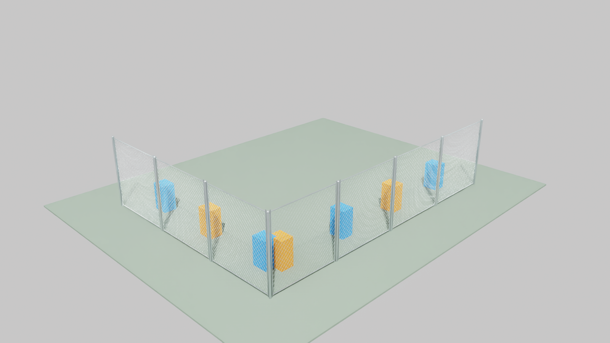

# Chain-link fence assets

Run `python fence/generate_fence.py` from the repository root to regenerate:

- `assets/chain_link_post.usda`: 2 m galvanized post with a rounded cap;
- `assets/chain_link_panel.usda`: 2 m by 2 m open diamond wire lattice,
  narrow vertical pipes, top and bottom rails, and an invisible planar collider;
- `fence_test_scene.usda`: seven referenced panels in two perpendicular runs,
  with eight posts including one shared corner post.

To reproduce the preview in Isaac Sim 6.1, run
`conda run -n isaacsim61-cu13 python fence/render_preview.py`.
The output is `fence_preview.png`.

The test scene uses metres and a Z-up frame. Its two runs are 6 m (+X) and
8 m (+Y), meeting at one corner post. Its ground top is at Z=0, so each pole
reaches the ground. Select `/World/InspectionCamera` in Isaac Sim 6.1 for a
view of both runs; colored markers behind the fence reveal the open mesh.
The panel collision plane is two-sided and static. As a zero-thickness
triangle surface it may need a finite-thickness replacement if high-speed
physics contacts prove unreliable.
The rails overlap the vertical pipes at the corners, and the wires terminate
at the rail centerlines. The static asset needs no additional structural frame.
